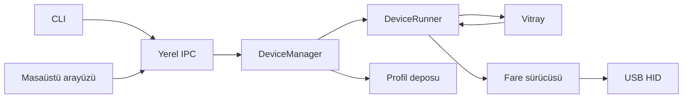

# Mimari

## Katmanlar

`DeviceManager` desteklenen HID arayüzlerini bulur, bağlantı tekrarını yönetir ve cihaz kimliğini çözer. Cihaz listesi kilit altında alınır; USB işlemi liste kilidi tutulurken yapılmaz. Başarısız bağlantı aktif listede bulunmaz. Kapanamayan USB işçisi ayrı takip edilerek aynı yol için ikinci işçi açılması engellenir.

`DeviceRunner` bir cihazın komutlarını ve animasyonunu koordine eder. Efekt oluşturma/doğrulama mevcut katman değiştirilmeden tamamlanır. İlk renk karesi başarılı yazıldıktan sonra yeni efekt etkin olur. `update-effect` aynı örneği korur; hız değişimi zaman fazını sıfırlamaz.

Bağlantı başına `session_id` vardır; USB yolu aynı kalsa da yeniden açılış yeni kimlik alır. Korumalı komut beklerken oturum değişirse kilit alındığında reddedilir. Render kilidi süreli alınır ve kapanış tekrar kontrol edilir; yeniden bağlantı kilidi tutulurken render'ın bitmesi beklenebilir. Geçici render hatası başarılı sonraki karede temizlenir.

`Vitray` sıralı katmanları, opaklığı, normal/add/multiply karışımını ve hedef bölgeleri işler. `ZoneMap` isimleri ve 0–1 arası fiziksel koordinatları tutar. Efektler yalnızca RGB renk listesi döndürür.

`BaseMouse` tek USB yazıcısı sağlar. Kontrol işlemleri bounded queue, RGB ise tek bekleyen kare alanı kullanır. Future sonucu gerçek yazmanın sonucudur. Sürücü önerilen ayarı önce doğrular; başarılı yazmadan sonra oturum durumuna geçirir.

`ProfileStore` doğrulanmış JSON profillerini saklar. Dosyadan gelen model/ayar/efekt bilgisi cihaz yazımı başlamadan doğrulanır. Birden çok USB raporu firmware açısından geri alınabilir işlem değildir; kısmi hata belirsiz durum yaratır.

Katalog `catalog_id` ile dosya adları listesini tanımlar. Birden fazla sayfa farklı kataloglara aitse istemci eksik liste uyarısı verir; tüm dosya içeriklerini tek işlemde kilitleyen bir snapshot değildir. Profil okuma, lstat/fstat kontrollerine ek olarak desteklenen platformda nonblocking/no-follow açılış kullanır.

Arayüz bir işçi ve sonuç kuyruğu kullanır. Tk bileşenlerine yalnızca ana iş parçacığı dokunur. Normal işlem sürerken yinelenen tıklamalar yeni iş biriktirmez; arka plan yenilemesi sürerken bir açık kullanıcı işlemi sıraya alınabilir. İşçi sonuçları yalnızca token/queue taşır; Tk callback'leri ana döngüde tutulur ve kapanışta kaldırılır. Demo aynı komut işleyicisini kullanır fakat USB handle yerine bellek içi taşıma açar.

`ui_client` komut başarısını ekran yenileme başarısından ayırır. `snapshot` tek bir servis çağrısında cihaz/servis durumuyla ilk profil sayfasını alır; gerekirse sınırlı katalog sayfaları devam ettirilir. Arayüz DPI, yoklama hızı, efekt ve bölge renkleri için ayrı düzenleme sayaçları tutar. Yeni bir yanıt, daha sonra düzenlenen girişlerin üzerine yazmaz. Cihaz değişimi yeni oturum durumuna geçirir.

İstemci servis yanıtının biçimini, ayarlarını, modelini, profil sayfasını ve sayfalamanın ilerlediğini ekrana ulaşmadan denetler. Yanıt nesnesi kopyalanır. Sonraki sayfanın bağlantı hatası ilk cihaz snapshot'ını silmez; bozuk protokol yanıtı ise reddedilir. Geçici cihaz meşgul durumunda son değerler ekranda kalır ve yeni yazımlar durur.

`profile_io` kullanıcı tarafından seçilen JSON dosyalarını yerel istemcide doğrular ve dışa aktarır; sunucuya keyfi dosya yolu iletilmez. `diagnostics` yalnızca ortamı inceler. Paket metadata'sı, CLI ve tanı raporu sürümü `app_version` modülünden alır.

## Cihaz ekleme

1. `BaseMouse` sürücüsünü, model kimliği, interface ve capability bilgileriyle uygulayın.
2. Paket oluşturmayı donanım yazımından ayırın; geçersiz istekte durum değiştirmeyin.
3. `managers/device_registry.py` açık listesini güncelleyin veya güvenilen başlangıç kodunda `register_driver` çağırın.
4. Paket, hata, yeniden bağlantı ve kapanış testlerini ekleyin.
5. Hedef cihazda sensör, tuş ve kalıcılık davranışını kaydedin.

Yeni sürücünün profil desteği için `validate_settings`, `apply_settings`, `get_profile`, `set_colors`, `get_zone_map` sözleşmeleri gerekir. Donanımdan okunmayan alanları bilinmiyor olarak koruyun. Ayrı marka için mevcut Rival paketleri kopyalanarak destek varsayılmamalıdır.

## Efekt ekleme

`BaseEffect` alt sınıfında `EFFECT_ID`, açık `PARAMS` ve `apply` tanımlanır. `apply` her bölge için 0–255 tam sayı kanallar döndürmelidir. Kayıt kimlikleri çakışamaz. Zaman için monotonic saat, parametre değişikliği için efekt kilidi kullanılır.

Yeni efektin geçerli frame, sınır değer, geçersiz parametre ve canlı güncelleme testlerini ekleyin. Efekt kodu HID modülüne veya sürücüye erişmemelidir.
