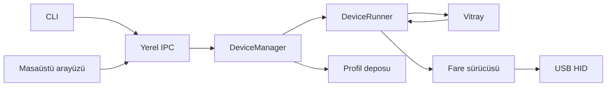

# Mimari

## Katmanlar

`DeviceManager` desteklenen HID arayüzlerini bulur, bağlantı tekrarını yönetir ve cihaz kimliğini çözer. Cihaz listesi kilit altında alınır; USB işlemi liste kilidi tutulurken yapılmaz. Başarısız bağlantı aktif listede bulunmaz. Kapanamayan USB işçisi ayrı takip edilerek aynı yol için ikinci işçi açılması engellenir.

`DeviceRunner` bir cihazın komutlarını ve animasyonunu koordine eder. Efekt oluşturma/doğrulama mevcut katman değiştirilmeden tamamlanır. İlk renk karesi başarılı yazıldıktan sonra yeni efekt etkin olur. `update-effect` aynı örneği korur; hız değişimi zaman fazını sıfırlamaz.

`Vitray` sıralı katmanları, opaklığı, normal/add/multiply karışımını ve hedef bölgeleri işler. `ZoneMap` isimleri ve 0–1 arası fiziksel koordinatları tutar. Efektler yalnızca RGB renk listesi döndürür.

`BaseMouse` tek USB yazıcısı sağlar. Kontrol işlemleri bounded queue, RGB ise tek bekleyen kare alanı kullanır. Future sonucu gerçek yazmanın sonucudur. Sürücü önerilen ayarı önce doğrular; başarılı yazmadan sonra oturum durumuna geçirir.

`ProfileStore` doğrulanmış JSON profillerini saklar. Dosyadan gelen model/ayar/efekt bilgisi cihaz yazımı başlamadan doğrulanır. Birden çok USB raporu firmware açısından geri alınabilir işlem değildir; kısmi hata belirsiz durum yaratır.

Arayüz bir işçi ve sonuç kuyruğu kullanır. Tk bileşenlerine yalnızca ana iş parçacığı dokunur. Bekleyen işlem varken yeni komut eklenmez. Demo aynı komut işleyicisini kullanır fakat USB handle yerine bellek içi taşıma açar.

## Cihaz ekleme

1. `BaseMouse` sürücüsünü, model kimliği, interface ve capability bilgileriyle uygulayın.
2. Paket oluşturmayı donanım yazımından ayırın; geçersiz istekte durum değiştirmeyin.
3. `managers/device_registry.py` açık listesini güncelleyin veya güvenilen başlangıç kodunda `register_driver` çağırın.
4. Paket, hata, yeniden bağlantı ve kapanış testlerini ekleyin.
5. Hedef cihazda sensör, tuş ve kalıcılık davranışını kaydedin.

Yeni sürücünün profil desteği için `validate_settings`, `apply_settings`, `get_profile`, `set_colors`, `get_zone_map` sözleşmeleri gerekir. Donanımdan okunmayan alanları bilinmiyor olarak koruyun. Ayrı marka için mevcut Rival paketleri kopyalanarak destek varsayılmamalıdır.

## Efekt ekleme

`BaseEffect` alt sınıfında `EFFECT_ID`, açık `PARAMS` ve `apply` tanımlanır. `apply` her bölge için 0–255 tam sayı kanallar döndürmelidir. Kayıt kimlikleri çakışamaz. Zaman için monotonic saat, parametre değişikliği için efekt kilidi kullanılır.

Yeni efektin geçerli frame, sınır değer, geçersiz parametre ve canlı güncelleme testlerini ekleyin. Efekt kodu HID modülüne veya sürücüye erişmemelidir.
