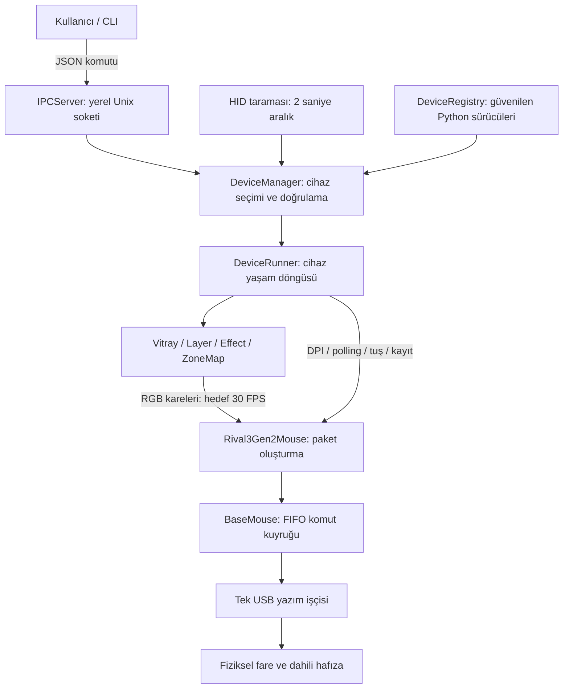

# Muvv: proje incelemesi, güvenlik bulguları ve geliştirme planı

**Tarih:** 11 Ekim 2026  
**Kapsam:** Kullanıcının özel GitHub depolarından indirdiği iki ZIP anlık görüntüsü.  
**Sonuç:** Mevcut katmanlı yapı geliştirmeye uygun. Ancak IPC erişimi, girdi doğrulaması, donanım işlem sonuçları ve kaynak yönetimi sağlamlaştırılmadan dağıtıma hazır kabul edilmemeli. Güvenlik çalışması; cihaz ayarlarını koruma, doğru geri bildirim ve kararlılıkla birlikte yürütülmeli.

## 1. Ne incelendi, ne doğrulandı?

| Arşiv | İçerik | Dosya | Açılmış boyut | ZIP yorumundaki kimlik |
|---|---|---:|---:|---|
| `Muvv-main.zip` | Uygulama kodu, protokol belgeleri, testler | 34 | 127.300 bayt | `b3466453ba3f8bdb697cd182832dae22318dfbf3` |
| `Muvv_development_environment-main.zip` | Vizyon, ortam notları, yol haritası, proje hafızası | 11 | 21.756 bayt | `addec62756896737c2ea23e85070e575a28bc8f6` |

Toplam **45 dosya, 4.049 metin satırı** incelendi. Bunların **29'u Python dosyası**, toplam 3.064 satır. İkinci ZIP ayrı bir uygulama değil; Muvv'nin geliştirme ve tasarım deposu.

ZIP yorumları commit SHA biçiminde; GitHub'daki commitlerle eşleştirilmedi. Repo adresleri, geçmiş, diğer dallar, Issues, PR'lar, GitHub Security uyarıları ve erişim politikaları bu incelemede mevcut değil. Rapor güncel uzak depoyu değil, bu iki dosyanın içerdiği kodu değerlendirir. Kullanıcının yönlendirmesiyle uzak repo araştırması sürdürülmedi.

Arşivlerde yol taşması, sembolik bağlantı ve aşırı açılmış boyut kontrolü yapıldı. Dosyalar okunurken ZIP CRC kontrolleri de uygulandı. Orijinal ZIP'ler korundu; kaynak kopyaları ayrı inceleme dizinine açıldı.

| Kontrol | Sonuç | Kanıtın sınırı |
|---|---|---|
| 29 Python dosyasını AST ile ayrıştırma ve bellekte derleme | Hata yok | Donanım veya işletim sistemi uyumluluğunu kanıtlamaz |
| Mevcut `unittest.TestCase` testleri | **6/6 geçti** | `hid` modülü engelleyici sahte modülle değiştirildi; USB kullanılmadı |
| Kontrollü çevrimdışı inceleme | **24 gözlem kaydı** | Bir kayıt mevcut 6 testi, bir kayıt doğru paket boylarını içerir; kalanlar hata/risk davranışlarını gösterir. 24 güvenlik açığı anlamına gelmez |
| Kaynak dosyalarını ilk envanterle SHA-256 karşılaştırma | **0 değişiklik** | İnceleme kaynak kodu düzeltmedi |
| Bilinen anahtar/token biçimleri ve sabit kimlik bilgisi atamaları | Eşleşme yok | Sınırlı örüntü taraması; tüm sırların veya geçmiş sızıntıların yokluğunu kanıtlamaz |
| Gerçek HID erişimi / gerçek IPC sunucusu | Kullanılmadı | Linux izinleri, fiziksel fare ve USB işlemleri canlı doğrulanmadı |

Çalışma ortamı Windows ve Python 3.12.10. Bu Python derlemesinde `AF_UNIX` ve `SO_PEERCRED` yok. Bu nedenle IPC denemeleri bellekteki sahte soketlerle yapıldı; gerçek Linux soket izinleri hakkında çalışma zamanı kanıtı üretilmedi. Hiçbir bağımlılık kurulmadı; yönetici yetkisi, udev/servis/registry değişikliği veya donanım testi yapılmadı.

**Kanıt dosyaları:** [Arşiv envanteri](D:/BRS/inceleme/kanitlar/arsiv-envanteri.json), [statik envanter](D:/BRS/inceleme/kanitlar/statik-envanter.json), [24 gözlemin ayrıntıları](D:/BRS/inceleme/kanitlar/offline-inceleme-sonuclari.json), [test ve tanılama kaydı](D:/BRS/inceleme/kanitlar/offline-inceleme-kaydi.txt).  
**Tüm dosyaların görevleri:** [Dosya haritası](D:/BRS/inceleme/DOSYA-HARITASI.md).

## 2. Proje aslında ne yapıyor?

Muvv, Linux'ta üreticilerin çevre birimi yazılımlarına alternatif olarak tasarlanan, Python tabanlı bir donanım kontrol çatısı. Bugünkü kod **tek somut fare sürücüsüne**, SteelSeries Rival 3 Gen 2 kablolu modele odaklanıyor. Çok marka desteği bir mimari hedef; mevcut cihaz kataloğu bu hedefin tamamlandığını göstermiyor.

Mevcut özellikler:

- USB HID cihazlarını tarama, VID/PID ve arayüz numarasıyla desteklenen cihazı ayırma.
- Takılan/çıkarılan fare için bir `DeviceRunner` oluşturma veya durdurma.
- Farenin aktif DPI kademesini ve polling rate değerini değiştirme.
- RGB renk üretme; bölge haritası, katman, normal/toplama/çarpma harmanlama.
- `wave` ve `breathing` efektleri; `set-color` yoluyla sabit renk.
- Fare tuşuna tek HID klavye kodu atama ve cihaz hafızasına kayıt komutunu kuyruğa koyma.
- CLI'dan yerel Unix soketine JSON komutları gönderme; cihaz ve yetenek bilgisi alma.

Bu ZIP'te web sitesi, HTTP API, kullanıcı hesabı, veritabanı veya bulut servisi bulunmuyor. Mevcut güvenlik yüzeyi ağırlıklı olarak **yerel süreçler, soket erişimi, Python eklentileri ve USB yazımları**. Web uygulamalarındaki SQL injection, XSS veya internet üzerinden giriş atlatma gibi açıklar için bu kaynakta bir karşılık tespit edilmedi.

Planlanan ama kaynakta tamamlanmamış işler: CustomTkinter GUI, tray, systemd kurulum dosyaları, udev kurulum sihirbazı, kullanıcı profillerini diske kaydetme/yükleme, tam makro düzenleyici, `evdev` tuş dinleme, Windows iletişim katmanı, diğer çevre birimleri, Spectrum Cycle ve çalışan efektin aynı nesne üzerinde IPC ile güncellenmesi.

`BaseEffect.update_parameters()` mevcut. Ancak IPC'deki `set-effect` her seferinde yeni efekt yaratıyor; bu, çalışan efektin zamanını ve katmanını koruyan ayrı bir canlı güncelleme API'si değil. `macro_support=True` bildirimi de bugünkü CLI'nın tam makro dizisi, kayıt veya editör sunduğu anlamına gelmiyor.

## 3. Mimari ve veri akışı



| Katman | Sorumluluk | Önemli durum |
|---|---|---|
| `cli.py` | Argparse komutları, renk/argüman işleme, JSON gönderme | `/tmp/muvv.sock` sabit; süre sınırı ve tam yanıt okuma yok |
| `IPCServer` | Bağlantı kabulü, JSON ayrıştırma, komut yönlendirme | Her bağlantı için yeni thread; istemci kimliği ve komut şeması doğrulaması eksik |
| `DeviceManager` | HID tarama, sürücü bulma, runner sözlüğü, cihaz seçme | Paylaşılan sözlük için kilit yok; başarısız runner da kayda girebiliyor |
| `DeviceRunner` | Bağlanma, render döngüsü, efekt değiştirme, sürücüye köprü | Efekt yaratmadan eski katmanları siliyor; sürücü dönüşü hataları yansıtmıyor |
| `BaseMouse` | Soyut sürücü sözleşmesi ve USB işçisi | FIFO yazımları sıralıyor; sınırsız kuyruk ve durmayan işçi var |
| `Rival3Gen2Mouse` | Cihaza özgü paket ve RAM ayarları | Tüm tuş/DPI durumunu RAM varsayımlarından üretiyor; donanımdan mevcut ayarları okumuyor |
| Animasyon katmanı | Zamana/konuma göre RGB hesaplama ve katman birleştirme | Donanımdan ayrışması iyi; parametre sınırları ve değişim tutarlılığı eksik |
| Registry'ler | Yerel Python sınıflarını keşfetme | Dosyaları import etmek kod çalıştırır; eklentiler güvenilen kod sayılmalı |

Tek süreç içinde bir tarama thread'i, her fare için bir render ve bir USB işçi thread'i, her IPC bağlantısı için ayrıca bir thread var. Gerçek I/O'nun tek işçide sıralanması yararlı. Ancak bu, RAM ayarlarının, katman değişikliklerinin veya birden çok paketten oluşan işlemlerin atomik olduğu anlamına gelmiyor.

Mevcut JSON sözleşmesi `command` ve `args` alanlarını kullanıyor; sonuçlar çoğunlukla `status: ok/error` ve `message`, `devices` veya `capabilities` alanlarıyla dönüyor. Komutlar `list`, `info`, `set-effect`, `set-color`, `set-dpi`, `set-polling`, `bind-key`, `save`. Bunlar geliştirme sırasında bir sözleşme olarak korunmalı veya açık sürüm geçişiyle değiştirilmelidir.

Sürücüde bildirilen VID `0x1038`, PID `0x1870`, arayüz `3`. DPI aralığı tabloda 200–8500; sürücü beş kademe yönetiyor. Polling seçenekleri 125/250/500/1000 Hz. DPI, polling, RGB, tuş ve kayıt komutları sırasıyla `0x34`, `0x2B`, `0x21`, `0x2A`, `0x11`. Bu model kimliği ve temel eşleşmeler açık kaynak [rivalcfg model tanımı](https://github.com/flozz/rivalcfg/blob/master/rivalcfg/devices/rival3_gen2.py) ile tutarlı. Bu karşılaştırma fiziksel cihaz veya firmware doğrulaması değildir.

## 4. Güvenlik modeli

Korunması gerekenler: farenin kullanılabilir kalması, mevcut tuş/DPI/profil ayarlarının bütünlüğü, cihaz hafızasına yazımın kontrollü olması, servis kaynakları ve kullanıcıya doğru işlem sonucu verilmesi.

Üç temel sınır var:

1. **IPC girişi:** Sokete erişebilen istemciden gelen JSON güvenilmez kabul edilmeli. Resmî CLI'nın argüman kontrolü bu sınırın yerine geçmez.
2. **Eklenti kodu:** Driver/efekt dosyaları veri değil, Python kodudur. Onaylanmış ve bütünlüğü korunan kurulumdan yüklenmelidir.
3. **USB I/O:** Paket üretmek, kuyruğa kabul etmek, işletim sistemine yazmak ve cihazın ayarı kalıcı uygulaması farklı aşamalardır.

Saldırı önkoşulu çoğu bulguda **yerel sokete erişim**. Aynı kullanıcı hesabındaki kötü niyetli bir süreç ile başka bir kullanıcının erişimi ayrı değerlendirilmeli. Sahip kullanıcıyı doğrulayan soket politikası farklı kullanıcıları ayırır; aynı hesapla çalışan her programı otomatik olarak güvenilir yapmaz. Bu kaynakta internetten erişilebilen bir dinleme portu veya doğrulanmış uzaktan kod çalıştırma açığı bulunmadı.

Aşağıdaki önem dereceleri dağıtım önceliğini ve etkiyi anlatır; CVSS puanı değildir. İşlevsel bütünlük hataları ayrıca belirtilmiştir. Bir hatanın bulunması, fareyi kalıcı olarak bozduğu veya root yetkisi kazandırdığı anlamına gelmez; böyle bir sonuç bu incelemede kanıtlanmadı.

## 5. Bulguların özeti

| ID | Bulgu | Önem / tür | Kanıt |
|---|---|---|---|
| G01 | Soket erişimi ve karşı taraf kimliği için açık politika yok | Yüksek, **dağıtım izinlerine bağlı** yetkilendirme riski | Kod incelemesi; Linux erişim testi yapılmadı |
| G02 | Sınırsız istemci thread'i ve bekleme; durdurmada istemciler kapanmıyor | Yüksek, yerel erişim sonrası hizmet engelleme | P18; sınırsız thread tasarımı kaynakta |
| G03 | Efekt seçenekleri yöntemleri ve iç alanları değiştirebiliyor; sayısal sınırlar eksik | Yüksek, yerel erişim sonrası render hizmetini bozma | P06–P08 |
| G04 | Reddedilen tuş ayarı RAM durumunu bozuyor; geçersiz tuş kayda gidiyor | Yüksek, cihaz ayarı bütünlüğü ve hata yönetimi | P03–P05 |
| G05 | USB hata/eksik yazımında istemciye başarı dönüyor | Yüksek, işlem bütünlüğü ve güvenilir geri bildirim | P19–P20 |
| G06 | Sınırsız USB kuyruğu, bloklanabilen kapanış, hiç bitmeyen işçi | Yüksek, kaynak tüketimi ve kullanılabilirlik | P21–P22 |
| G07 | Konfigürasyon+kayıt dizisi atomik değil; paylaşılan durum korunmuyor | Orta; cihaz etkisi ayrıca ölçülmeli | P17 kontrollü zamanlama + kod incelemesi |
| G08 | Komut ve capability doğrulaması katı değil; eksik yetenekler kabul ediliyor | Orta, doğrulama sınırı | P11–P14 |
| G09 | Otomatik Python eklenti importu için dağıtım/güven politikası yok | Orta, **kurulum ve dosya yazma izinlerine bağlı** | Registry kaynakları; IPC'den keyfi import kanıtlanmadı |
| G10 | Bağımlılıklar sürüm/hash ile sabitlenmemiş; tekrar üretilebilir paket yok | Orta, tedarik zinciri ve sürüm yönetimi eksikliği | `requirements.txt`; belirli bir CVE kanıtı yok |

### G01 — IPC erişimi ve sabit `/tmp` yolu

**Kaynak:** [ipc_server.py:14](D:/BRS/inceleme/kaynak/Muvv-main/managers/ipc_server.py:14), başlangıç/temizlik satırları 26–32 ve 56–57; [CLI bağlantısı](D:/BRS/inceleme/kaynak/Muvv-main/cli.py:6).

Soket `/tmp/muvv.sock` üzerinde oluşturuluyor. Kod sahiplik/izin veya peer UID doğrulamıyor; başlangıç ve kapanışta bu yolda bir nesne varsa koşulsuz silmeye çalışıyor. İkinci servis aynı kullanıcı altında ilk servisin canlı soket adını kaldırabilir. İstemci de karşı taraftaki süreci doğrulamıyor.

**Önemli sınır:** Linux'ta bu sokete bağlanmak için soket dosyasında yazma izni gerekir; başlangıç izinleri `umask` etkisiyle oluşur. Dolayısıyla “her kullanıcı şu anda fareyi kontrol edebilir” iddiası mevcut kanıtı aşar. Örneğin `022` ile başka kullanıcıların yazma izni olmayabilir; daha açık izinler riski değiştirir. Peer kimliği `SO_PEERCRED` ile alınabilir. [Linux unix(7) açıklaması](https://manpages.debian.org/bookworm/manpages/unix.7.en.html).

**Yapılmalı:** Kullanıcı servisi için sahibi/izinleri doğrulanmış `$XDG_RUNTIME_DIR/muvv/` dizini, kullanıcıya özel soket, açık izin politikası, peer UID kontrolü ve tek örnek kilidi. Eski soket temizliği yalnız beklenen sahip/tür kontrolünden ve canlı servis ayrımından sonra yapılmalı. XDG runtime dizini kullanıcıya ait ve `0700` olmalıdır. [XDG Base Directory Specification](https://specifications.freedesktop.org/basedir/latest/).

**Kabul:** Linux'ta izinli kullanıcı bağlanır; ikinci kullanıcı reddedilir; iki farklı kullanıcı birbirinin soketini silmez; ikinci servis mevcut servisi bozmaz; başka süreç tarafından sahiplenilen yol güvenli hata üretir. Root daemon varsayımı yapılmadan gerçek kurulum incelenmeli.

### G02 — İstemci sayısı ve bekleme süresi sınırsız

**Kaynak:** [ipc_server.py:61](D:/BRS/inceleme/kaynak/Muvv-main/managers/ipc_server.py:61), thread oluşturma 70–72 ve `recv` 80; [CLI alımı](D:/BRS/inceleme/kaynak/Muvv-main/cli.py:19).

Her bağlantı yeni thread açıyor; istemci hiçbir veri göndermeden bekletebilir. `listen(5)` aktif istemci sayısını sınırlamaz. Sunucu ve CLI tarafında alım/gönderim için süre sınırı yok. `stop()` yalnız dinleme soketini yönetiyor; aktif istemci soketlerini izleyip kapatmıyor.

P18'de dört sahte istemci kontrollü biçimde `recv` içinde bekletildi. Servis durdurulduğunda hiçbir istemci kapanmadı. Deneme gerçek ağa veya gerçek UDS'ye bağlantı kurmadı; sınırsız kabul tasarımı ayrıca kaynakta doğrulandı.

**Yapılmalı:** Sınırlı istemci işçisi/semafor, bağlantı ve toplam istek süre sınırı, aktif istemci takibi, kapanışta soketleri kapatıp işçileri bekleme. Ayar ve kalıcı kayıt komutlarına da makul hız sınırı koyulmalı.

**Kabul:** Sessiz istemci süre sonunda kapanır; istemci sınırı aşıldığında kontrollü hata oluşur; kapanış bitince servis sahipliğinde istemci işçisi kalmaz; CLI yanıt vermeyen servis yüzünden süresiz beklemez.

### G03 — Efekt parametreleri doğrulanmadan nesneye yazılıyor

**Kaynak:** [IPC seçenek aktarımı](D:/BRS/inceleme/kaynak/Muvv-main/managers/ipc_server.py:125), [BaseEffect güncellemesi](D:/BRS/inceleme/kaynak/Muvv-main/animations/effects/base_effect.py:26), [runner efekt oluşturma](D:/BRS/inceleme/kaynak/Muvv-main/managers/device_runner.py:143).

IPC, `device/effect` dışındaki alanları seçenek olarak geçiriyor. `update_parameters()` mevcut olan her alanı `setattr` ile değiştiriyor; yöntem ve özel alanları ayırmıyor. Ayrıca Wave kurucusunun koyduğu minimum dalga boyu, sonradan parametre güncellenince atlanıyor.

Doğrulanan davranışlar:

- `wave_length=0`: IPC başarı döndürüyor; render `ZeroDivisionError` veriyor.
- `apply="overwritten"`: Efektin yöntemi metne dönüşüyor; render `TypeError` veriyor.
- `speed=NaN`: JSON ayrıştırıcı bunu kabul ediyor; render `ValueError` veriyor.

Bu, render hizmetini bozma ve nesne alanlarını kontrolsüz değiştirme problemidir. JSON'dan işletim sistemi komutu veya keyfi Python kodu çalıştırıldığı kanıtlanmadı.

**Yapılmalı:** Efekt başına izinli alan, katı tip, RGB uzunluğu/aralığı, sonlu sayı, hız/dalga boyu ve yön doğrulaması. Bilinmeyen/özel alanlar hata üretmeli. Yeni efekt tamamen hazırlanıp doğrulandıktan sonra aktif katmanla atomik değiştirilmelidir.

**Kabul:** Bu üç giriş reddedilir; önceki efekt aynı durumuyla çalışmaya devam eder; bozuk giriş USB kuyruğunu etkilemez. Renk ve hız sınırlamasının kullanıcı deneyimiyle tutarlı aralıkları ayrıca tanımlanmalı.

### G04 — Reddedilen tuş atamasında iç durum korunmuyor

**Kaynak:** [rival3_gen2.py:361](D:/BRS/inceleme/kaynak/Muvv-main/drivers/steelseries/rival3_gen2.py:361), özellikle `button_config.update()` 375 ve sol tık koruması 402–407; [runner dönüşü](D:/BRS/inceleme/kaynak/Muvv-main/managers/device_runner.py:236).

Sürücü önce RAM konfigürasyonunu değiştiriyor, sonra paket ve sol tık güvenliğini kontrol ediyor. Ret durumunda RAM geri alınmıyor. Driver metodu bazı hatalarda yalnız `return` yaptığı için runner bunu başarılı çağrı sayıyor.

P03'te tek sol tık `button1` klavye tuşuna çevrilmeye çalışıldı: donanıma paket gönderilmesi koruma tarafından engellendi, ancak IPC `ok` döndü ve RAM'deki sol tık değişmiş kaldı. Ardından normal bir yan tuş ataması da paket üretmedi. **Mevcut koruma bu denemede fiziksel sol tıkı kaldırmadı; sorun hatalı başarı ve iç durumun bozulması.**

P04'te tanımsız buton kabul edildi, RAM'e eklendi, normal tuş paketi ve kalıcı kayıt paketi kuyruğa girdi. P05'te `key_code=999` reddedildi, fakat RAM'de kaldı; sonraki geçerli başka buton işlemi de bu bozuk değerden etkilendi.

**Yapılmalı:** Önce kopya durum üzerinde tüm butonları/kodları ve korunması gereken işlevleri doğrulama, sonra paket üretimi, sonra tanımlı işlem sonucuyla durum geçişi. Başarısız girişte eski durum değişmemeli. Hatalar yazdırılıp yutulmamalı. Kurtarma/varsayılanlara dönme yolu bulunmalı.

**Kabul:** Üç negatif denemede RAM ve paket kuyruğu değişmez; IPC açık hata verir; takip eden geçerli komut başarılı olur. Sol tık, tekerlek ve mevcut kullanıcı eşlemelerinin korunması gerçek cihaz kabulünde ayrıca doğrulanır.

### G05 — Kuyruğa koymak donanım başarısı sayılıyor

**Kaynak:** [BaseMouse USB işçisi](D:/BRS/inceleme/kaynak/Muvv-main/drivers/base_mouse.py:46), [DPI köprüsü](D:/BRS/inceleme/kaynak/Muvv-main/managers/device_runner.py:202), [kayıt köprüsü](D:/BRS/inceleme/kaynak/Muvv-main/managers/device_runner.py:255).

Driver çağrısı çoğunlukla paketi kuyruğa ekleyip dönüyor. Runner hemen `True`, IPC hemen “ayarlandı/kaydedildi” döndürüyor. Sonraki USB işçisi hata alırsa yalnız yazdırıyor; istemciye sonuç taşımıyor. `device.write()` dönüşü de kontrol edilmiyor.

P19'da sahte yazıcı `OSError` verdi; DPI komutunun IPC sonucu yine `ok` oldu. P20'de sahte yazıcı sıfır bayt yazdığını bildirdi; IPC “hafızaya kaydedildi” dedi. Bunlar fiziksel ayarın gerçekten değiştiğini göstermez.

**Yapılmalı:** İşlem kimliği ve kuyruk/yazım/başarısızlık durumunu taşıyan sonuç mekanizması; yazım hatası ve dönüş değerini üst katmana aktarım. Protokol destekliyorsa yanıt/ayar okuma ile cihaz doğrulaması. `hid_write` gerçek yazılan miktarı veya hata döndürür ve ilk bayt Report ID'dir; backend farkları dikkate alınmalıdır. Bu nedenle tüm paketlere düşünmeden fazladan sıfır eklenmemeli. [HIDAPI API](https://libusb.info/hidapi/group__API.html).

**Kabul:** Yazıcı hata veya eksik sonuç verdiğinde istemci bunu öğrenir. Kuyruğa kabul edilen komuta “kalıcı kaydedildi” denmez. Cihaz onayı yoksa ürün yalnız doğrulayabildiği aşamayı bildirir.

### G06 — Kuyruk baskısı ve yaşam döngüsü

**Kaynak:** [BaseMouse oluşturma](D:/BRS/inceleme/kaynak/Muvv-main/drivers/base_mouse.py:26), `Queue()` 37, sonsuz işçi döngüsü 51 ve `join()` 85; [runner kapanışı](D:/BRS/inceleme/kaynak/Muvv-main/managers/device_runner.py:78).

USB kuyruğu sınırsız. Render hedefi 30 FPS olduğundan yavaş/bloklanan USB'de eski kareler birikebilir; yoğun komut gönderimi de aynı kuyruğu büyütür. İşçi constructor sırasında başlıyor ve durma işareti yok. `disconnect()` kuyruk bitene kadar süresiz bekliyor. Native yazım bloke olursa kapanış da takılabilir. Runner'daki iki saniyelik thread beklemesi, sonradan yapılan driver `join()` beklemesini sınırlamıyor.

P21'de tek sahte yazım bekletilirken 24 ek kare üretildi; 24 paket bekledi ve `maxsize=0` görüldü. P22'de `disconnect()` sahte I/O serbest bırakılana kadar bekledi; bağlantı kapandıktan sonra USB işçisi hâlâ canlıydı. Büyük yük veya fiziksel cihaz deneyi yapılmadı.

**Yapılmalı:** Kontrol komutları için sınırlı kuyruk, RGB için son kareyi koruyan birleştirme, süreli işlem takibi, bağlantı kopuşunda eski işleri iptal etme, açık işçi çıkışı ve tamamlanan `stop()`. Native çağrıyı güvenli kesme yöntemi backend'e göre incelenmeli; yalnız bir Python thread bayrağının bloklanmış C çağrısını durduracağı varsayılmamalı. Gerekirse I/O süreç izolasyonu değerlendirilir.

**Kabul:** Yavaş I/O'da bellek kullanımı sınırlı; stop/connect/disconnect tekrarlarında thread sayısı artmıyor; kapanışın tanımlı üst süresi var; RGB kaybı kontrol komutunun kaybolmasına dönüşmüyor.

### G07 — Atomik kayıt ve paylaşılan durum eksikliği

**Kaynak:** [tuş+kayıt kuyruğu](D:/BRS/inceleme/kaynak/Muvv-main/drivers/steelseries/rival3_gen2.py:409), [kilit tanımı](D:/BRS/inceleme/kaynak/Muvv-main/drivers/base_mouse.py:33), [manager sözlüğü](D:/BRS/inceleme/kaynak/Muvv-main/managers/device_manager.py:131).

Tek USB işçisi paketleri sırayla yazar; fakat tuş konfigürasyonu ve kayıt iki ayrı `put()` ile ekleniyor. Başka üretici araya RGB veya başka ayar koyabilir. P17'nin kontrollü zamanlamasında sıra **`0x2A → 0x21 → 0x11`** oldu. Bu işlem sırasının mümkün olduğunu gösterir; fare firmware'inin bu sıradan zarar gördüğünü göstermez.

`self.lock` tanımlı ama incelenen kodda kullanılmıyor. Tarama thread'i, IPC thread'leri ve render thread'i runner sözlüğü, katman listesi ve ayar durumunu eşzamanlı kullanıyor. Hotplug sırasında listeleme/hedef çözümleme hataları veya tutarsız kareler oluşması kaynak incelemesine dayanan ek risk; bunlar gerçek donanım yarış testiyle doğrulanmadı.

**Yapılmalı:** Cihaz başına seri komut yürütücüsü veya açık kilit sahipliği; birden çok paketi tek işlem olarak kuyruğa koyma; immutable/snapshot ayarlar ve katman değişimi. USB beklemesi sırasında genel manager kilidi tutulmamalı. Kalıcı kayıt sıklığı kontrol edilmeli; `bind-key` şu anda ayrıca `save` olmadan kayıt paketi üretiyor. Hafıza ömrüne etkisi ölçülmedi.

**Kabul:** Eşzamanlı renk/tuş/DPI isteklerinde konfigürasyon+kayıt işlemi bölünmez; hotplug/stop sırasında sözlük yarışı yok; belge ile gerçek eşzamanlılık davranışı uyuşur.

### G08 — Katı şema ve capability doğrulaması yok

**Kaynak:** [validator.py](D:/BRS/inceleme/kaynak/Muvv-main/managers/validator.py:8), [schemas.py](D:/BRS/inceleme/kaynak/Muvv-main/schemas.py:6), [IPC dönüştürmeleri](D:/BRS/inceleme/kaynak/Muvv-main/managers/ipc_server.py:154).

`TypedDict` tanımları çalışma zamanında JSON doğrulamaz. DPI için boş capability beş kademe varsayımıyla kabul ediliyor; boş/missing polling listesi her hıza izin veriyor. `validate_button()` sadece metin kontrol ediyor ve manager'ın tuş yolunda çağrılmıyor. Şemada `dpi/rgb/polling_rates` için `None` mümkün; validator/CLI bazı yerlerde sözlük varsayıyor.

P12'de `level=True` birinci kademe, `level=2.9` ikinci kademe olarak kabul edildi. P13 boş capability ve hayali butonun kabulünü doğruladı. P11'de `FF0000junk` ve beş haneli `FFFFF` renk kabul edildi; ikincisi `(255,255,15)` üretti. P14'te JSON dizi veya geçersiz UTF-8 kontrollü hata yanıtı üretmeden bağlantıyı kapattı; tüm servisin çöktüğü gözlenmedi.

**Yapılmalı:** Komut nesnesi/args tipi, cihaz kimliği, beklenen alanlar, sayısal türler, sınırlar ve desteklenen özellikler tek komut şemasında doğrulanmalı. Eksik yetenek varsayılan olarak reddedilmeli. DPI `stages` ve `range` ayrılmalı. Klavye kodu byte sınırı ve desteklenen HID kullanım kümesine göre denetlenmeli; başka markaların yetenekleri doğru temsil edilmeli.

**Kabul:** Boş capability ile ayar değişmez; bool/fraction/None/yanlış tipler açık hata verir; geçersiz buton ve renk hiçbir durum değişikliği yapmaz; komut katmanlarını doğrudan kullanma testleri de bu sınırları kapsar.

### G09 — Eklentiler güvenilen kod sınırı içinde

**Kaynak:** [device_registry.py:31](D:/BRS/inceleme/kaynak/Muvv-main/managers/device_registry.py:31), [effect_registry.py:31](D:/BRS/inceleme/kaynak/Muvv-main/animations/effect_registry.py:31).

Registry dosyaları keşfedip import ediyor; Python importu üst seviye kodu çalıştırır. Sınıfın `BaseMouse/BaseEffect` alt sınıfı olması güvenlik sandbox'ı değildir. Kod dosyası yazabilen bir tarafın yetkisi ve servisin hangi kullanıcıyla çalıştığı belirleyici. Özellikle daha düşük yetkili tarafın değiştirebildiği dizinden root ile yükleme tehlikelidir; mevcut kurulumda böyle bir durum doğrulanmadı.

IPC'deki efekt adı registry lookup'ı yapıyor; istemcinin istediği modülü doğrudan import etmiyor. Dolayısıyla keyfi modül adı vererek uzaktan kod yürütme bulgusu yok.

**Yapılmalı:** Onaylı eklenti manifesti, bütünlük korunan kurulum, açık geliştirici modu, deterministik kayıt ve isim/VID-PID çakışmalarını reddetme. Eklenti metadatası ve yetenekleri doğrulanmalı. Tam sandbox gereksinimi çıkarsa süreç izolasyonu ayrıca tasarlanmalı; sadece Python reflection ile çözüldüğü söylenmemeli.

### G10 — Bağımlılık ve paketleme eksikliği

**Kaynak:** [requirements.txt](D:/BRS/inceleme/kaynak/Muvv-main/requirements.txt:1), [.gitignore](D:/BRS/inceleme/kaynak/Muvv-main/.gitignore:1).

`hidapi`, `customtkinter`, `numpy` sürümsüz yazılmış. Lock/hash, paket manifesti, `pyproject.toml`, sürümleme, CI ve yayın kabul dosyaları bu ZIP'te yok. Kurulmuş gerçek sürümler bilinmediği için belirli bir CVE veya bağımlılık güvenliği sonucu üretilemez. `numpy/customtkinter` incelenen uygulama kodunda henüz kullanılmıyor; gelecekteki özellikler için listede görünüyor.

**Yapılmalı:** Temiz ortamda uyumlu sürümleri doğrulama, platform/Python matrisi, sürüm ve gerektiğinde hash ile sabitleme, dependency/secret taramasını CI'ya ekleme. Çekirdek ve gelecekteki GUI/hesaplama bağımlılıklarını ayırma değerlendirilebilir. Native HID kütüphanesi de paket kabulüne dahil edilmeli.

`.gitignore` kaynakta sanal ortam/üretim kalıntılarını kapsıyor; `.env`/özel anahtar politikası ayrıca tanımlanabilir. Bu dosyaların şu anda ZIP'te bulunduğu iddia edilmiyor. Gitignore geçmişte takip edilen veya yayımlanmış bir sırrı geri almaz; geçmiş incelemesi için daha sonra repo erişimi gerekir.

## 6. Güvenlik dışında önemli ürün ve kalite sorunları

| Konu | Mevcut davranış / risk | Öneri |
|---|---|---|
| Statik efekt | CLI `static` sunuyor, registry yalnız `staticcolor` kaydediyor; sınıfın zorunlu `color` argümanı parametresiz factory çağrısıyla uyuşmuyor. P09 doğruladı | Açık efekt kimliği/alias, parametre metadatası ve doğru factory |
| Hatalı efekt isteği | Eski katmanlar önce siliniyor. Bilinmeyen efekt mevcut ışığı kaldırıyor; “cihaz bulunamadı” mesajı yanıltıcı. P10 | Doğrulama ve oluşturma başarılı olduktan sonra tek değişim; ayrı hata kodu |
| Wave hızı | `get_time()` hızı çarpıyor; `Wave.apply()` tekrar çarpıyor. Hız karesine dönüşüyor. P24 | Hız katsayısını bir kez uygula; görsel/zaman testleri ekle |
| Başarısız bağlantı | `runner.start()` başarısız olsa da manager sözlüğüne ekleniyor. Aynı yol sonraki taramada tekrar denenmiyor. P23 | Gerçek bağlantı durumu, hata nedeni ve sınırlı yeniden deneme |
| Cihaz seçimi | Kısmi isim birden çok cihazla eşleşse de ilkini seçiyor. İndeks ve `default` hotplug sırasına bağlı. P16 | Belirsizliği bildir; kalıcı işlemlerde net cihaz seçimi |
| Mevcut cihaz profili | Driver RAM'i sabit varsayılanlarla açılıyor; mevcut cihaz ayarları okunmuyor. DPI komutu tüm beş slotu, tuş komutu tüm eşlemeyi gönderiyor | Protokol izin veriyorsa oku; yoksa bütün değişiklikleri önizle ve varsayılanları cihazdan okunmuş gibi sunma |
| İlk bağlantı / kapanış | Boş Vitray katmanları siyah kare üretir; stop LED'leri siyaha ayarlar. Önceki aydınlatma geri yüklenmiyor | Profil sahipliği ve bağlantı/kapanış davranışını ürün kararı olarak tanımla |
| DPI kademe düzenleyici | `set_dpi_stages()` driver'da ve manuel testte var, CLI/IPC'de yok | Yetenek temelli doğrulamayla üst katmanlara ekle |
| CLI otomasyonu | Sunucudan hata cevabı alındığında çoğu yol sadece yazdırıyor; süreç exit code'u başarı olarak kalabilir. Argüman sırası sezgisel değiştiriliyor | Açık exit code, JSON çıktısı ve belgelenmiş sabit sözdizimi |
| Kalıcı profil | Cihazda `save` var; bilgisayarda profil dosyası/preset deposu yok | Kullanıcıya ait sürümlü JSON profil, atomik dosya yazımı ve bozuk profil kurtarma |
| Zamanlama | Efekt ve render hesabı duvar saatini kullanıyor | Süre hesabında monoton saat; FPS ve USB kuyruk gecikmesini ölç |
| Test kalitesi | 7 donanım/manuel akış var; bazıları hata yakalayıp normal dönüyor. Manager testi cihaz yokken “Passing test” diyor | Otomatik/manuel donanım testlerini ayır; cihaz yoksa açık skip, beklenmeyen hatada fail |
| Dokümantasyon | `Note.md` “kusursuz”, progress “Lock ile çözüldü” diyor; kod ve kontrollü gözlemler bunları desteklemiyor. Tasarım yol haritası da eski | İddiaları doğrulama tarihi/kanıtıyla güncelle; bilinen hataları kaydet |
| Dağıtım | README, LICENSE, installer ve systemd/udev dosyaları yok | Kurulum/kaldırma, desteklenen cihaz/OS listesi, lisans ve sürüm kabulü |

IPC mesajlaşması da bir kalite ve dayanıklılık sorunu: iki taraf tek `recv(4096)` ile tam JSON geldiğini varsayıyor. P14/P15'te parçalı geçerli mesaj reddedildi. Akış soketleri mesaj sınırını kendiliğinden vermez; bir frame protokolü gerekir. [Python Socket HOWTO](https://docs.python.org/3.12/howto/sockets.html).

Sunucunun mevcut tek okuması 4.096 baytla sınırlı; bu sınırsız JSON yükü aldığı anlamına gelmiyor. Ancak parçalanma, uzun cevap ve gerçek mesaj sonu yönetimi yok. Boyut sınırı bulunan uzunluk başlığı veya satır protokolü, iki uçta tam okuma döngüsü ve açık protokol sürümüyle uygulanmalı. Çok cihazlı liste/gelecekteki geniş capability cevabı da 4.096 bayt üstü için test edilmeli.

## 7. Neyi korumalıyız?

- Driver, animasyon, manager ve arayüz ayrımını. Tüm sistemi yeniden yazmak için gerekçe yok.
- VID/PID ve HID arayüzü üzerinden desteklenen cihaz seçimini; yeni cihaz eklerken model/firmware kanıtını.
- Donanım bağımsız ZoneMap/Vitray/Layer yapısını ve bölgesel efekt yaklaşımını.
- USB için tek yazıcı ilkesini; bunu atomik işler ve sınırlı kuyrukla güçlendirmeyi.
- Mevcut CLI komutlarını ve `status/message/devices/capabilities` alanlarını; değişim gerekiyorsa kontrollü sürüm geçişini.
- Alt sürücüdeki sol tık korumasını; doğrulamayı üst katmana eklemek alt katmandaki korumayı kaldırmamalı.
- Gerçekten geçen 6 testi; yeni testler bunların yanına eklenmeli.
- Ana kod ve geliştirme deposunun ayrı yönetimini. `development environment.md` bunu açıkça belirtiyor.
- Kaynak/protokol belgelerini ve üçüncü taraf kaynak atıflarını. Önceki sürümler ve orijinal ZIP'ler korunmalı.

İyi olan noktalar da var: `eval/exec`, shell çalıştırma, pickle ile güvenilmez yük açma ve uygulama kaynaklarında HTTP dinleme yolu görülmedi. Desteklenen cihaz filtreleme, JSON kullanımı, sürücülerde sınırlı paket oluşturma, sol tık kontrolü ve USB yazım sıralaması olumlu temeller. Bunlar tek başına genel bir “güvenli” sertifikası değildir.

## 8. Önerilen geliştirme sırası ve kabul koşulları

### Aşama 0 — Referans ve sözleşme

Bu inceleme kod anlık görüntüsü olarak korunur. Geliştirme ayrı çalışma kopyası/dalında başlatılır; iki repo karıştırılmaz. Desteklenen ilk platform ve test faresi netleştirilir. Komut/çıktı sözleşmesi, gerçek cihaz kimliği, paket örnekleri ve mevcut 6 test başlangıç kabulü olur. Güvenlik bildiriminin aslı daha sonra paylaşılırsa buradaki bulgularla eşleştirilir; bugün aynı açıkları kapsadığı iddia edilmez.

**Bitti sayma koşulu:** Tekrarlanabilir başlangıç testleri, mevcut özellik tablosu ve paket/girdi sözleşmesi var; eski kaynak ve kullanıcı ayarları korunuyor.

### Aşama 1 — Yerel erişim ve IPC dayanıklılığı

`ipc_server.py` ve `cli.py` birlikte ele alınır: kullanıcıya özel soket, izin/peer kontrolü, tek örnek yönetimi, süre/istemci sınırı, frame protokolü, güvenli hata cevabı ve kapanış. Linux'ta kullanıcı servisi öncelikli olur. Udev gerekiyorsa yalnız desteklenen HID cihazına erişim verilmesi tasarlanır; bütün daemon'a kalıcı root yetkisi verilmez.

**Bitti sayma koşulu:** Farklı kullanıcı reddi, aynı anda iki servis, stale/başkasına ait yol, parçalı/uzun mesaj, sessiz istemci ve kapanış gerçek Linux testlerinde geçer. Windows mock sonucu Linux yetkilendirme kabulü yerine kullanılmaz.

### Aşama 2 — Şema, capability ve tutarlı durum

Komut şemaları, efekt seçenekleri ve buton/HID kod doğrulaması uygulanır. Hatalı giriş eski durumu korur. Static effect kimliği/factory düzeltilir. DeviceManager, runner ve driver'ın hata/sonuç sözleşmesi tanımlanır. Yeteneği olmayan cihazda özellik kapatılır veya açık hata verilir.

**Bitti sayma koşulu:** G03/G04/G08 denemeleri artık güvenli ret verir; önceki efekt ve ayarlar değişmez; geçerli komutlar mevcut davranışı korur; `static`, `wave`, `breathing` doğru kurulabilir.

### Aşama 3 — İşlem sonuçları, USB kuyruğu ve kapanış

Donanım işlem kimliği/sonuç takibi, sınırlı kuyruk, son RGB kare birleştirme, atomik konfigürasyon+kayıt, durdurulabilir işçi ve reconnect hata durumları eklenir. I/O beklemesinde kilitlenme ve native backend davranışı ayrı ele alınır. Kalıcı kayıt kontrolü ve hata halinde kurtarma belirlenir.

**Bitti sayma koşulu:** Hata/eksik yazım doğru yansır; backlog sınırlı; worker kapanır; hotplug sonrası iyileşme var; çok paketli işlem bölünmez. Aynı senaryolar sahte yazıcı ve gerçek cihaz aşamalarında ayrı kaydedilir.

### Aşama 4 — Kullanıcı ayarlarını koruyan ürün davranışı

Cihazın mevcut durumunun okunabilirliği araştırılır. Profil/preset yönetimi, DPI kademe düzenleyici, açık cihaz seçimi, işlem önizleme, geri dönüş ve hatalı profil kurtarma hazırlanır. Wave hızı ve CLI exit code'ları düzeltilir. Arayüz, doğru işlem sonuçları hazır olduğunda bu API üzerinde geliştirilir.

**Bitti sayma koşulu:** Kullanıcı eski profiline dönebilir; tek ayar değişikliği açıklanmadan başka ayarları sıfırlamaz; cihaz kopması/kayıt hatası arayüzde anlaşılırdır; temel komutlar GUI kapalıyken çalışır.

### Aşama 5 — Paketleme ve genişleme

Sürüm/bağımlılık sabitleme, CI, README/lisans ve kontrollü Linux kurulumu hazırlanır. Başka marka/cihaz, Spectrum Cycle, gerçekten canlı efekt güncelleme ve Windows portu aynı kabul ölçütleriyle eklenir. `evdev`/tuş dinleme ve tam makrolar ayrı bir güvenlik/mahremiyet tasarımıyla başlatılır.

**Bitti sayma koşulu:** Temiz ortam kurulumu tekrar üretilebilir; hangi cihaz/firmware/platformun sınandığı açık; kullanılmayan bağımlılıklar gözden geçirilmiş; yeni sürücü sözleşme testlerini geçiyor. Paylaşım/yayın izni ve lisans ayrıca net.

## 9. Yapılmaması gerekenler

1. Sistemi baştan yazıp mevcut driver/CLI sözleşmelerini gereksiz yere kırmak.
2. CLI kontrolünü yeterli görüp JSON IPC ve driver sınırlarını açık bırakmak.
3. Daemon'ı sürekli root ile çalıştırmak veya tüm `hidraw` cihazlarına genel `0666` erişimi vermek.
4. Yerel soketi geliştirme kolaylığı için kontrolsüz TCP/HTTP veya internet servisine çevirmek.
5. Kuyruğa kabulü “cihazda uygulandı”, host yazımını “kalıcı profil doğrulandı” diye sunmak.
6. Bozuk istekte RAM'i/aktif efekti değiştirmek; sol tık korumasını kaldırmak; bir paket dizisini sırf FIFO var diye atomik saymak.
7. Gerçek farede kontrolsüz paket fuzzing'i, gelişigüzel kayıt fırtınası veya protokol byte'larını tahminle değiştirmek.
8. Tüm HID paketlerine körlemesine byte eklemek veya çıkarmak. Bu anlık görüntüde incelenen normal paketler **64 bayt**; kayıt paketinde boyut hatası doğrulanmadı.
9. Başlangıç varsayılanlarını gerçek cihazdan okunmuş ayar/geri yükleme yedeği saymak.
10. Toplu test keşfiyle manuel donanım fonksiyonlarını farkında olmadan çalıştırmak; cihaz bulunamadığı için dönen testi başarılı donanım kanıtı saymak.
11. Denetimsiz eklenti dosyasını güvenlik sandbox'ı varmış gibi import etmek; root ile kullanıcı yazılabilir eklenti dizininden yüklemek.
12. Özel kaynak, geliştirme notu veya kullanıcı profilini public depoya/yayına taşımak. Açık kaynak vizyonu, bu özel paylaşım için yayın izni değildir.
13. Sürümsüz `requirements.txt` ile “bağımlılık açıkları kapandı” demek; Windows/offline testlerini Linux/fiziksel cihaz kabulü yerine koymak.
14. Mevcut 6 test geçtiği için ürünü yayın hazır saymak veya eski dokümanlardaki tamamlandı işaretlerini güncel çalışma kanıtı kabul etmek.

## 10. Sonraki doğrulama matrisi

| Test alanı | Ortam | Beklenen kabul |
|---|---|---|
| Komut şeması / capability | Donanımsız otomatik test | Yanlış tip, bilinmeyen alan, unsupported özellik güvenli ret; durum değişmez |
| Efekt atomik değişimi | Donanımsız motor | Geçersiz efekt/renk/hız/dalga boyu önceki render'ı korur |
| Buton işlemi | Sahte HID / paket yakalama | Geçersiz kod ve sol tık retinde RAM aynı; valid işlem sonrası tam paket doğru |
| USB sonuçları | Hata/eksik/bloklanan sahte yazıcı | Sonuçlar doğru, süre sınırları tanımlı, kuyruk ve kapanış sınırlı |
| Atomik komutlar | Kontrollü thread zamanlama | Konfigürasyon+kayıt bölünmez; paylaşılan durum tutarlı |
| IPC frame / istemci sınırı | Linux, gerçek UDS, donanımsız manager | Parçalı/uzun mesaj, sessiz istemci ve aşırı istemci kontrollü yönetilir |
| Kullanıcı ayrımı | Linux, iki test hesabı | İzinli sahip kabul; diğer kullanıcı ret; socket/kurulum dosyaları doğru sahipte |
| Cihaz yaşam döngüsü | Önce sahte tarama, sonra gerçek fare | Başarısız bağlantı iyileşir; tekrar tak/çıkar thread sızıntısı yapmaz |
| Mevcut ayarların korunması | Onaylı test faresi, bilinen profil | DPI/tuş/RGB değişimi dışındaki ayarlar korunur; kurtarma çalışır |
| Kalıcılık | Gerçek cihaz, tak/çıkar ve gerekiyorsa yeniden açılış | Kayıt ancak doğrulanan kapsamda başarılı gösterilir |
| Paket/kurulum | Temiz hedef Linux ortamı | Rootless çalışma, dar cihaz erişimi, açık kaldırma, sürüm/bağımlılık kanıtı |
| Windows portu | Windows'a özgü IPC + gerçek cihaz | Destek iddiası ancak platform kabulü sonrası; bugünkü ZIP bunu sağlamıyor |

Gerçek fare testine geçmeden test cihazı, mevcut profil ve kurtarma yöntemi belirlenmeli. Yeni sürüme geçmiş ZIP/kanıtın eski arşivle karışmaması için sonuçlarda kod kimliği, ortam ve doğrulama seviyesi yazılmalı.

## 11. İnceleme araçları ve tekrar üretim

Araçlar kaynak repo içine konmadı; `D:\BRS\inceleme\araclar\` altında tutuldu. [Çevrimdışı tanılama](D:/BRS/inceleme/araclar/offline_audit.py) gerçek `hid` erişimini engeller, uygulama daemon'ını başlatmaz ve yalnız açık `unittest` sınıflarını çalıştırır. Gerçek soket yerine bellek içi taşıma kullanır. P17 işlem aralığını kontrollü olarak taklit eder; fiziksel yarış kanıtı değildir.

Tekrar çalıştırma:

```powershell
python -B 'D:\BRS\inceleme\araclar\offline_audit.py'
```

Bu komut rapor kanıt dosyalarını yeniden üretir; uygulama kaynaklarını değiştirmez. Arşiv açma aracı mevcut kaynakların üzerine yazmayı reddeder; yeniden açmak gerektiğinde ayrı bir hedef kullanılmalıdır. Tanılama aracı mevcut hataları gösterir; düzeltilmiş kodun regresyon paketi yerine otomatik olarak kullanılmamalıdır. Beklenen düzeltilmiş davranış her gözlemde ayrıca verilmiştir.

**Arşiv SHA-256:**

```text
Muvv-main.zip
fcc49418b97ce5fca3a497d64b184a3209be1bb5aa311f2ec077050c5e14f726

Muvv_development_environment-main.zip
5f0b28138324b97a21592f1848d9782d4fac7974b80064e8b8d53dcd6f460979
```

## 12. Karar

**İlk geliştirme paketi:** G01–G06 ve IPC framing/şema işleri. Bunlar erişim, girdi, durum ve işlem sonucu temelini kurar. Ardından atomik kayıt, reconnect, mevcut profil koruması ve ürün iyileştirmeleri tamamlanır. GUI ve yeni markalar bu temel üzerinde büyür.

Bu aşamada kod düzeltmesi, repo değişikliği veya yayın yapılmadı. Ortaya çıkan sonuç; tüm dosyaların görevini açıklayan harita, kontrollü kanıtlar, öncelikli açıklar ve mevcut sistemi koruyan uygulanabilir geliştirme planıdır.
