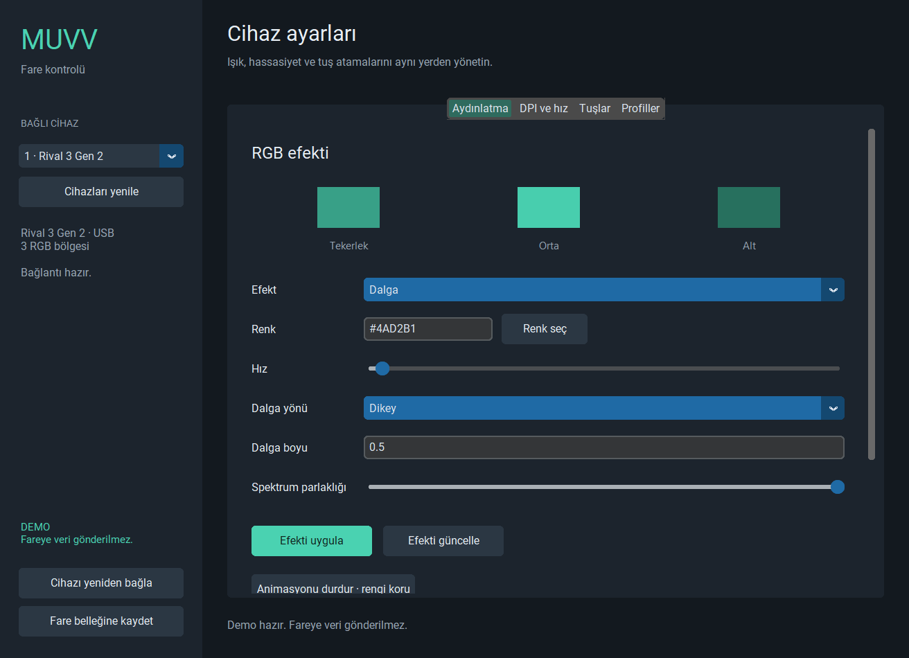

# Muvv 0.4.0 çalışma kontrolü

12 Ekim 2026. Uygulama kaynakları son 0.4.0 teslimiyle birebir eşleşti; yeni uygulama kodu değişikliği gerekmedi.

## Sonuç

Windows'ta demo arayüzü açıldı ve çalıştı. RGB/efekt, DPI, tuş ve profil akışları otomatik testlerle sınandı. Gerçek fare servisi Linux'a özgüdür. Linux, udev/systemd, fiziksel Rival 3 Gen 2 ve firmware kalıcılığı bu kontrolde doğrulanmadı.

| Kontrol | Sonuç |
|---|---|
| Otomatik testler | 176 test: 162 geçti, 14 Linux/POSIX testi atlandı, 0 başarısızlık, 0 hata. |
| Gerçek Tk arayüzü | Testlerin içinde 33 GUI senaryosu; ayrıca dört sekmeli demo kullanım kontrolü ve altı güncel görüntü. |
| Sanal mesaj ve USB akışları | 500 parçalı mesaj, 400 eşzamanlı işlem / 1.200 rapor; rapor karışması yok. |
| Yeniden bağlantı ve profiller | 50 yeni oturum, 50 eski komutun engellenmesi, 50 dosya aktarımı, 100 yeniden adlandırma. |
| USB kesilmesi | Dört hata noktası; yanlış başarı ve hatadan sonra ek yazım yok. |
| Kod denetimi | Ruff denetimi ve 57 dosyanın biçim denetimi geçti. |
| Söz dizimi | 64 Python dosyası 3.10 söz dizimiyle ayrıştırıldı; bu Python 3.10 çalışma zamanı testi değildir. |
| Temiz kurulum | Windows demo başlatıcısı ayrı sanal ortamda hashli bağımlılıkları ve wheel'i kurdu; pip check ve sürüm komutu geçti. |
| Kurulu uygulama | GUI'nin normal demo giriş noktası ve DPI/RGB/efekt akışları Python 3.14.5 ile çalıştı; modüller site-packages içinden yüklendi. |
| Kapanış | Arayüz callback hatası ve kalan Muvv işçisi yok. |
| Kaynak/paket eşleşmesi | 83 uygulama + 12 geliştirme dosyası; wheel içindeki 34 modül kaynakla aynı. |
| Önceki teslimler | 50 eski teslim dosyasının SHA-256 değeri korundu. |

## Son güncellemelerin kontrolü

0.3'e göre 19 dosyada değişiklik var. Cihaz listesi ve bağlantı oturumu aynı anı temsil ediyor; bağlantı yenilenince eski oturumun yazımı engelleniyor. Kapanış çok raporlu USB işlemindeki kalan raporları durduruyor. CLI ve GUI profil sayfalarını ortak biçimde doğruluyor; katalog değişimi ve bozuk sayfa yanlış başarı oluşturmuyor. Profil hatası cihaz kontrollerini kapatmıyor; tarama ve erişim nedenleri ekranda gösteriliyor. Bu davranışların regresyon testleri mevcut tam koşuda geçti.

## Paylaşım

[Başlangıç ve kurulum](BASLANGIC.md). `DEMO-BASLAT.cmd` Windows demosunu açar; ilk kurulum için Python 3.10+ ve internet gerekir. Başlatıcı yalnızca çıkarılan proje klasörünün `.venv` ortamını kullanır. ZIP kaynak teslimidir; bağımsız Windows EXE içermez.

Güncel kanıtlar: [test sonuçları](kontrol-20261012/test-sonuclari.json), [test kaydı](kontrol-20261012/test-kaydi.log), [sanal senaryolar](kontrol-20261012/sanal-senaryolar.json), [temiz kurulum](kontrol-20261012/temiz-kurulum.json), [kaynak kontrolü](kontrol-20261012/kaynak-kontrolu.json).

Güncel demo görüntüsü:

`gelistirme-0.4` ve `GELISTIRME-0.4-RAPORU.md` 11 Ekim'in tarihsel geliştirme kanıtlarıdır. Yeni kayıtlar `kontrol-20261012` altındadır. Fiziksel HID bu testlerde açılmadı.
